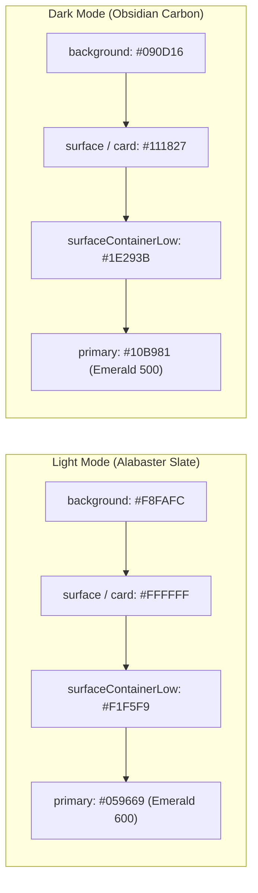
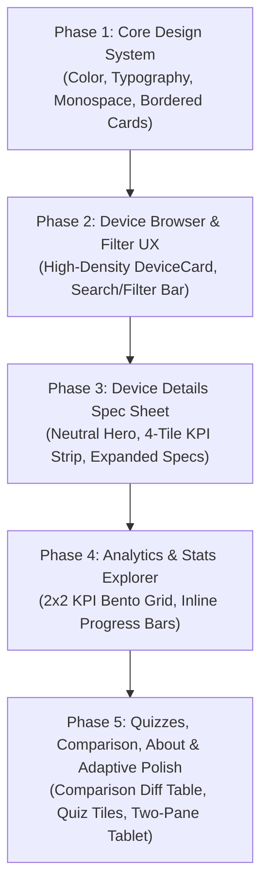

# Android Device Universe (`dev.hossain.devicecatalog`) — UI/UX Overhaul Report & Phased Execution Plan

> [!IMPORTANT]
> **Purpose of this Document**: This is a self-contained, end-to-end architectural and design specification for an AI coding agent working inside `/Users/hossain/dev/repos/android-apps/device-catalog-app`. It ports the **"Developer Precision Console"** design language from the companion web application ([`device-catalog-webapp/DESIGN_SYSTEM.md`](file:///Users/hossain/dev/repos/web-apps/device-catalog-webapp/DESIGN_SYSTEM.md)) into native **Jetpack Compose + Material 3** for Android phones, foldables, and tablets.

---

## 1. Executive Summary & Design Philosophy

### 1.1 Background Context
The companion web application (`device-catalog-webapp`) recently underwent a complete UI/UX overhaul (PR [#142](https://github.com/hossain-khan/device-catalog-webapp/pull/142) & PR [#143](https://github.com/hossain-khan/device-catalog-webapp/pull/143)) that transformed it from a yellowish-green, low-density prototype into a high-density **"Developer Precision Console"** inspired by Linear, Vercel, Raycast, and Android Studio's Device Manager.

The Android app (`dev.hossain.devicecatalog`) shares the same underlying Google Play Device Catalog dataset (23,000+ devices) and has a strong technical architecture (**Jetpack Compose**, **Slack Circuit** MVI, **Metro** DI, **Room + Paging 3**, and adaptive `WindowSizeClass` layouts). However, its visual layer currently suffers from the exact same pitfalls the web app had before its overhaul.

### 1.2 Core Design Pillars to Port to Android
1. **Precision Over Decoration**: Replace full-bleed pastel/saturated card backgrounds with crisp **Slate/Zinc neutral surfaces**, subtle `1.dp` hairline borders (`outlineVariant`), and restrained semantic badges.
2. **High-Density Scannability**: Android engineers open this app to inspect **SDK/API levels**, **RAM**, **SoC/Processor**, **Screen Density (DPI)**, **ABI architectures**, and **Hardware Codenames** (`device`). Cards and headers must surface these telemetry points at a glance.
3. **Typographic Discipline**:
   - **UI Sans (`Inter` / `Plus Jakarta Sans`)**: Clean geometric hierarchy for model names, navigation, and headings.
   - **Technical Monospace (`JetBrains Mono` / `Roboto Mono`)**: Mandatory for hardware codenames (`husky`, `e3q`), ABIs (`arm64-v8a`), screen resolutions/densities (`480dpi`), and API levels (`API 34`).
   - **Tabular Numerals (`fontFeatureSettings = "tnum"`)**: Mandatory on all counts, KPIs, and percentages so columns align vertically.
4. **Adaptive Dual-Theme Parity**: Crisp **Alabaster Slate** light mode (`#F8FAFC` background / `#FFFFFF` cards) and **Obsidian Carbon** dark mode (`#090D16` background / `#111827` cards) accented by **Android Emerald** (`#059669` light / `#10B981` dark).

---

## 2. Comprehensive Audit of Current UI/UX Issues

### 2.1 Theme & Color System (`core:designsystem`)
- **Files**:
  - [`core/designsystem/src/main/kotlin/dev/hossain/devicecatalog/core/designsystem/theme/Color.kt`](file:///Users/hossain/dev/repos/android-apps/device-catalog-app/core/designsystem/src/main/kotlin/dev/hossain/devicecatalog/core/designsystem/theme/Color.kt)
  - [`core/designsystem/src/main/kotlin/dev/hossain/devicecatalog/core/designsystem/theme/Theme.kt`](file:///Users/hossain/dev/repos/android-apps/device-catalog-app/core/designsystem/src/main/kotlin/dev/hossain/devicecatalog/core/designsystem/theme/Theme.kt)
  - [`core/designsystem/src/main/kotlin/dev/hossain/devicecatalog/core/designsystem/theme/DeviceTypeColors.kt`](file:///Users/hossain/dev/repos/android-apps/device-catalog-app/core/designsystem/src/main/kotlin/dev/hossain/devicecatalog/core/designsystem/theme/DeviceTypeColors.kt)
- **Current Issues**:
  1. **Muddy Olive-Green Surface Cast**: `backgroundLight = Color(0xFFF9FAEF)` and `surfaceContainerLight = Color(0xFFEEEFE3)` tint the entire app with a dated yellowish-mossy hue.
  2. **Dynamic Color Mismatch**: `DeviceCatalogAppTheme` sets `dynamicColor: Boolean = true` by default (contradicting its own KDoc on lines 109–110), causing user wallpaper colors to clash with hardcoded `chartVibrant*` and `DeviceTypeColors`.
  3. **Heavy Pastel Form-Factor Fills**: `DeviceTypeColors` defines opaque pastel fills used to flood entire hero cards (`DeviceHeroCard`) and large `56.dp` boxes rather than subtle semantic pills + `2.dp` accent bars.

### 2.2 Typography (`core:designsystem`)
- **File**: [`core/designsystem/src/main/kotlin/dev/hossain/devicecatalog/core/designsystem/theme/Type.kt`](file:///Users/hossain/dev/repos/android-apps/device-catalog-app/core/designsystem/src/main/kotlin/dev/hossain/devicecatalog/core/designsystem/theme/Type.kt)
- **Current Issues**:
  1. Uses Google Font `Lato` across all 15 Material 3 text styles with default tracking and weights.
  2. No monospace `FontFamily` (`JetBrains Mono` or `Roboto Mono`) for technical identifiers.
  3. No `fontFeatureSettings = "tnum"` helper or token for numerical metrics.

### 2.3 Device Browser, Search & Cards (`feature:devices`)
- **Files**:
  - [`feature/devices/src/main/kotlin/dev/hossain/devicecatalog/feature/devices/DevicesUi.kt`](file:///Users/hossain/dev/repos/android-apps/device-catalog-app/feature/devices/src/main/kotlin/dev/hossain/devicecatalog/feature/devices/DevicesUi.kt)
  - [`feature/devices/src/main/kotlin/dev/hossain/devicecatalog/feature/devices/components/DeviceCard.kt`](file:///Users/hossain/dev/repos/android-apps/device-catalog-app/feature/devices/src/main/kotlin/dev/hossain/devicecatalog/feature/devices/components/DeviceCard.kt)
  - [`feature/devices/src/main/kotlin/dev/hossain/devicecatalog/feature/devices/components/DeviceSearchBar.kt`](file:///Users/hossain/dev/repos/android-apps/device-catalog-app/feature/devices/src/main/kotlin/dev/hossain/devicecatalog/feature/devices/components/DeviceSearchBar.kt)
  - [`feature/devices/src/main/kotlin/dev/hossain/devicecatalog/feature/devices/components/FilterBottomSheet.kt`](file:///Users/hossain/dev/repos/android-apps/device-catalog-app/feature/devices/src/main/kotlin/dev/hossain/devicecatalog/feature/devices/components/FilterBottomSheet.kt)
- **Current Issues**:
  1. **Low-Information `DeviceCard`**: Only displays a `56.dp` colored icon square and 3 plain lines (`modelName`, `Manufacturer • device`, `RAM • FormFactor`). Crucial hardware specs (`sdkVersions`, `processorName`, `screenDensities`, `abis`) are completely absent from the card.
  2. **Lack of Card Hierarchy**: Manufacturer, model name, and codename have nearly identical visual treatment. Cards lack a subtle `1.dp` border and top/left form-factor indicator bar.
  3. **Disconnected Filter UX**: Filtering relies on a floating green FAB at the bottom-right that obscures list content instead of an integrated Search + Filter Control Bar with active filter count badges and quick-toggle form factor chips.

### 2.4 Device Details Screen (`feature:devicedetails`)
- **File**: [`feature/devicedetails/src/main/kotlin/dev/hossain/devicecatalog/feature/devicedetails/DeviceDetailsUi.kt`](file:///Users/hossain/dev/repos/android-apps/device-catalog-app/feature/devicedetails/src/main/kotlin/dev/hossain/devicecatalog/feature/devicedetails/DeviceDetailsUi.kt)
- **Current Issues**:
  1. **Full-Bleed Pastel `DeviceHeroCard`**: Floods the top card with `deviceColor`, placing a white box inside a pastel card with centered text below it.
  2. **No At-a-Glance Telemetry Strip**: Forces users to scroll and expand accordions to see basic specs.
  3. **Hidden Critical Sections**: `ScreenInfoCard` (sizes, DPI) and `PlatformInfoCard` (ABIs, SDK versions, OpenGL ES) have `defaultExpanded = false`, hiding the exact specs Android developers open the details page to see.

### 2.5 Statistics & Stats Explorer (`feature:statistics`, `feature:statsexplorer`)
- **Files**:
  - [`feature/statistics/src/main/kotlin/dev/hossain/devicecatalog/feature/statistics/DeviceStatsUi.kt`](file:///Users/hossain/dev/repos/android-apps/device-catalog-app/feature/statistics/src/main/kotlin/dev/hossain/devicecatalog/feature/statistics/DeviceStatsUi.kt)
  - [`feature/statistics/src/main/kotlin/dev/hossain/devicecatalog/feature/statistics/components/MetricCards.kt`](file:///Users/hossain/dev/repos/android-apps/device-catalog-app/feature/statistics/src/main/kotlin/dev/hossain/devicecatalog/feature/statistics/components/MetricCards.kt)
  - [`feature/statistics/src/main/kotlin/dev/hossain/devicecatalog/feature/statistics/components/StatisticsCharts.kt`](file:///Users/hossain/dev/repos/android-apps/device-catalog-app/feature/statistics/src/main/kotlin/dev/hossain/devicecatalog/feature/statistics/components/StatisticsCharts.kt)
  - [`feature/statsexplorer/src/main/kotlin/dev/hossain/devicecatalog/feature/statsexplorer/StatsExplorerUi.kt`](file:///Users/hossain/dev/repos/android-apps/device-catalog-app/feature/statsexplorer/src/main/kotlin/dev/hossain/devicecatalog/feature/statsexplorer/StatsExplorerUi.kt)
- **Current Issues**:
  1. **Giant Solid-Color Pager Cards (`SwipeableMetricCards`)**: Takes up ~200dp of vertical space to show 1 number at a time on a loud solid green/blue/orange/purple card, requiring 5 horizontal swipes to read 5 numbers.
  2. **Wall of Collapsed Accordions**: 6 out of 8 analytics cards are collapsed by default.
  3. **Dated Custom Charts**: Thin donut ring and clashing rainbow bars lack inline progress tracks, rank badges (`#1`, `#2`), tabular numerals, and percentage pills.

### 2.6 Quiz Hub, Comparison & About (`feature:quizhub`, `feature:devicecomparison`, `feature:aboutapp`)
- **Files**:
  - [`feature/quizhub/src/main/kotlin/dev/hossain/devicecatalog/feature/quizhub/QuizHubUi.kt`](file:///Users/hossain/dev/repos/android-apps/device-catalog-app/feature/quizhub/src/main/kotlin/dev/hossain/devicecatalog/feature/quizhub/QuizHubUi.kt)
  - [`feature/devicecomparison/src/main/kotlin/dev/hossain/devicecatalog/feature/devicecomparison/DeviceComparisonUi.kt`](file:///Users/hossain/dev/repos/android-apps/device-catalog-app/feature/devicecomparison/src/main/kotlin/dev/hossain/devicecatalog/feature/devicecomparison/DeviceComparisonUi.kt)
  - [`feature/aboutapp/src/main/kotlin/dev/hossain/devicecatalog/feature/aboutapp/AboutUi.kt`](file:///Users/hossain/dev/repos/android-apps/device-catalog-app/feature/aboutapp/src/main/kotlin/dev/hossain/devicecatalog/feature/aboutapp/AboutUi.kt)
- **Current Issues**:
  1. `AboutUi` has oversized centered imagery and basic list items instead of a structured developer telemetry & links layout.
  2. `ComparisonTable` and `QuizTile` need updated surface borders, monospace spec values, and semantic badge styling.

---

## 3. Target Design System Specification (Android / Material 3)

### 3.1 Color Tokens (`Color.kt`)



| Material 3 Role | Light Token (`Color.kt`) | Dark Token (`Color.kt`) | Usage |
| :--- | :--- | :--- | :--- |
| `background` | `0xFFF8FAFC` (Slate 50) | `0xFF090D16` (Obsidian) | App canvas background |
| `onBackground` | `0xFF0F172A` (Slate 900) | `0xFFF8FAFC` (Slate 50) | Primary canvas text |
| `surface` | `0xFFFFFFFF` (Pure White) | `0xFF111827` (Gray 900) | Top app bars, primary cards, sheets |
| `onSurface` | `0xFF0F172A` (Slate 900) | `0xFFF8FAFC` (Slate 50) | Primary text on cards |
| `surfaceVariant` | `0xFFF1F5F9` (Slate 100) | `0xFF1E293B` (Slate 800) | Spec pills, code badges, recessed wells |
| `onSurfaceVariant` | `0xFF475569` (Slate 600) | `0xFF94A3B8` (Slate 400) | Secondary labels, eyebrows, metadata |
| `surfaceContainerLowest` | `0xFFFFFFFF` | `0xFF06090F` | Deepest inset container |
| `surfaceContainerLow` | `0xFFFFFFFF` | `0xFF111827` | Default elevated card container |
| `surfaceContainer` | `0xFFF1F5F9` | `0xFF1E293B` | Secondary container / chip background |
| `surfaceContainerHigh` | `0xFFE2E8F0` | `0xFF283548` | Hover/pressed/active container |
| `surfaceContainerHighest` | `0xFFCBD5E1` | `0xFF334155` | Highest emphasis neutral container |
| `primary` | `0xFF059669` (Emerald 600) | `0xFF10B981` (Emerald 500) | Primary brand accent, active indicators |
| `onPrimary` | `0xFFFFFFFF` | `0xFF022C22` | Text/icons on primary buttons |
| `primaryContainer` | `0xFFD1FAE5` (Emerald 100) | `0xFF064E3B` (Emerald 900) | Active nav pill, primary badge fill |
| `onPrimaryContainer` | `0xFF065F46` (Emerald 800) | `0xFFA7F3D0` (Emerald 200) | Text/icons inside `primaryContainer` |
| `secondary` | `0xFF2563EB` (Blue 600) | `0xFF60A5FA` (Blue 400) | Secondary telemetry & analytical accent |
| `secondaryContainer` | `0xFFDBEAFE` (Blue 100) | `0xFF1E3A8A` (Blue 900) | Secondary badge container |
| `onSecondaryContainer` | `0xFF1E40AF` | `0xFFBFDBFE` | Text on secondary container |
| `tertiary` | `0xFF7C3AED` (Violet 600) | `0xFFA78BFA` (Violet 400) | Tertiary accent (quizzes / insights) |
| `tertiaryContainer` | `0xFFEDE9FE` | `0xFF4C1D95` | Tertiary container |
| `onTertiaryContainer` | `0xFF5B21B6` | `0xFFDDD6FE` | Text on tertiary container |
| `outline` | `0xFF94A3B8` (Slate 400) | `0xFF475569` (Slate 600) | Input outlines, focused borders |
| `outlineVariant` | `0xFFE2E8F0` (Slate 200) | `0xFF1E293B` (Slate 800) | **`1.dp` Card & Divider Hairline Borders** |

### 3.2 Semantic Form-Factor Palette (`DeviceTypeColors.kt`)
Instead of flooding whole cards with opaque pastels, each `FormFactor` maps to:
1. **`accentColor`**: Vibrant semantic color for the `2.dp` top/left accent bar, icon tint, and chart bar.
2. **`containerColor`**: Subtle `12%–15%` alpha tint (or crisp 100/900 shade) for form-factor badges and icon wells.
3. **`onContainerColor`**: High-contrast text/icon color inside the badge.

| Form Factor | Light Accent / Text | Light Badge Fill | Dark Accent / Text | Dark Badge Fill |
| :--- | :--- | :--- | :--- | :--- |
| **Phone** | `0xFF059669` (Emerald) | `0xFFECFDF5` | `0xFF34D399` | `0xFF064E3B` |
| **Tablet** | `0xFF2563EB` (Blue) | `0xFFEFF6FF` | `0xFF60A5FA` | `0xFF1E3A8A` |
| **TV** | `0xFF7C3AED` (Purple) | `0xFFF5F3FF` | `0xFFC084FC` | `0xFF4C1D95` |
| **Wearable** | `0xFFD97706` (Amber) | `0xFFFFFBEB` | `0xFFFBBF24` | `0xFF78350F` |
| **Chromebook** | `0xFF0891B2` (Cyan) | `0xFFECFEFF` | `0xFF22D3EE` | `0xFF164E63` |
| **Automotive** | `0xFFE11D48` (Rose) | `0xFFFFF1F2` | `0xFFFB7185` | `0xFF881337` |
| **XR / Cars / Other** | `0xFF4F46E5` (Indigo) | `0xFFEEF2FF` | `0xFF818CF8` | `0xFF312E81` |

---

## 4. Phased Implementation Plan

> [!TIP]
> **Recommended Workflow for the AI Agent**: Execute one phase at a time. At the end of each phase, run `./gradlew testDebugUnitTest` and `./gradlew assembleDebug` to verify compilation, unit tests, and KSP/Circuit code generation before moving to the next phase.



---

### Phase 1: Core Design System Overhaul (`core:designsystem`)

#### Goal
Replace the olive-green theme with the **Slate/Zinc + Android Emerald** palette, introduce `Plus Jakarta Sans` / `Inter` + `JetBrains Mono` typography with tabular numerals, and update core components (`DeviceCatalogCard`, `DeviceTypeColors`).

#### Files to Modify
1. [`core/designsystem/src/main/kotlin/dev/hossain/devicecatalog/core/designsystem/theme/Color.kt`](file:///Users/hossain/dev/repos/android-apps/device-catalog-app/core/designsystem/src/main/kotlin/dev/hossain/devicecatalog/core/designsystem/theme/Color.kt)
   - Replace all light/dark color constants with the **Slate/Zinc + Android Emerald** tokens from Section 3.1.
   - Update `chartVibrant1..8` to the cohesive data visualization palette (Emerald, Blue, Violet, Amber, Cyan, Rose, Indigo, Teal).
2. [`core/designsystem/src/main/kotlin/dev/hossain/devicecatalog/core/designsystem/theme/Theme.kt`](file:///Users/hossain/dev/repos/android-apps/device-catalog-app/core/designsystem/src/main/kotlin/dev/hossain/devicecatalog/core/designsystem/theme/Theme.kt)
   - Change `dynamicColor: Boolean = false` by default in `DeviceCatalogAppTheme` so the curated developer console palette is consistent across all Android versions unless explicitly enabled.
3. [`core/designsystem/src/main/kotlin/dev/hossain/devicecatalog/core/designsystem/theme/DeviceTypeColors.kt`](file:///Users/hossain/dev/repos/android-apps/device-catalog-app/core/designsystem/src/main/kotlin/dev/hossain/devicecatalog/core/designsystem/theme/DeviceTypeColors.kt)
   - Update `LightDeviceTypeColors` and `DarkDeviceTypeColors` to the semantic badge colors in Section 3.2 and add helper methods `accentColorFor(formFactor: FormFactor): Color` (for `2.dp` accent bars and icons) alongside `colorFor` (badge container) and `onColorFor` (badge text).
4. [`core/designsystem/src/main/kotlin/dev/hossain/devicecatalog/core/designsystem/theme/Type.kt`](file:///Users/hossain/dev/repos/android-apps/device-catalog-app/core/designsystem/src/main/kotlin/dev/hossain/devicecatalog/core/designsystem/theme/Type.kt)
   - Switch `displayFontFamily` and `bodyFontFamily` from `"Lato"` to `"Inter"` (or `"Plus Jakarta Sans"`).
   - Add `val monoFontFamily = FontFamily(Font(googleFont = GoogleFont("JetBrains Mono"), fontProvider = provider))` and expose a convenient extension `val Typography.monoCode: TextStyle` and `val TextStyle.tabularNums: TextStyle get() = copy(fontFeatureSettings = "tnum")`.
5. [`core/designsystem/src/main/kotlin/dev/hossain/devicecatalog/core/designsystem/component/DeviceCatalogCard.kt`](file:///Users/hossain/dev/repos/android-apps/device-catalog-app/core/designsystem/src/main/kotlin/dev/hossain/devicecatalog/core/designsystem/component/DeviceCatalogCard.kt)
   - Update `DeviceCatalogCard` to use `MaterialTheme.colorScheme.surfaceContainerLow` (`#FFFFFF` light / `#111827` dark), `RoundedCornerShape(12.dp)`, `0.dp` tonal elevation boost, and a crisp `BorderStroke(1.dp, MaterialTheme.colorScheme.outlineVariant)`.
6. [`core/designsystem/src/test/kotlin/dev/hossain/devicecatalog/core/designsystem/theme/ColorThemeTest.kt`](file:///Users/hossain/dev/repos/android-apps/device-catalog-app/core/designsystem/src/test/kotlin/dev/hossain/devicecatalog/core/designsystem/theme/ColorThemeTest.kt)
   - **Important**: Update the hardcoded hex assertions in `ColorThemeTest` to match the new Emerald/Slate tokens (`primaryLight = Color(0xFF059669)`, `primaryDark = Color(0xFF10B981)`, etc.) so unit tests pass!

#### Phase 1 Verification
- Run `./gradlew :core:designsystem:testDebugUnitTest`

---

### Phase 2: High-Density Device Browser, Cards & Filter UX (`feature:devices`)

#### Goal
Transform the main catalog screen (`DevicesUi`) into a high-density hardware browser where developers can immediately scan Manufacturer, Model Name, Monospace Codename, Form Factor badge, and 4 key hardware telemetry pills (`RAM`, `API Level`, `Processor/SoC`, `DPI`) on every card.

#### Files to Modify
1. [`feature/devices/src/main/kotlin/dev/hossain/devicecatalog/feature/devices/components/DeviceCard.kt`](file:///Users/hossain/dev/repos/android-apps/device-catalog-app/feature/devices/src/main/kotlin/dev/hossain/devicecatalog/feature/devices/components/DeviceCard.kt)
   - **Surface & Border**: Use `Card` with `containerColor = MaterialTheme.colorScheme.surface`, `shape = RoundedCornerShape(12.dp)`, and `border = BorderStroke(1.dp, MaterialTheme.colorScheme.outlineVariant)`.
   - **Semantic Top/Leading Accent**: Draw a `3.dp` vertical accent bar along the left edge (or `2.dp` top edge) using `deviceTypeColors.accentColorFor(device.androidDevice.formFactor)`.
   - **Header Row**:
     - Left: Compact `40.dp` rounded-lg (`8.dp`) form-factor icon badge (`containerColor = deviceColor`, icon tinted with `onDeviceColor`) + Uppercase Manufacturer eyebrow (`labelSmall`, `letterSpacing = 0.8.sp`, `fontWeight = FontWeight.Bold`, `color = onSurfaceVariant`) + Bold Model Name (`titleMedium`, `fontWeight = FontWeight.Bold`, `color = onSurface`).
     - Right: Form-factor pill badge (`Phone`, `Tablet`, `TV`, etc.) + Monospace codename chip (`device.androidDevice.device`, using `monoFontFamily` on `surfaceVariant` background) when `device != modelName`.
   - **Bottom Telemetry Strip (4 Spec Pills)**:
     - A clean `HorizontalDivider(color = outlineVariant.copy(alpha = 0.6f))` followed by a compact row of spec chips (`surfaceVariant` background, `6.dp` corner radius, `monoFontFamily` / `tabularNums`):
       1. **RAM**: `RamFormatter.formatRamToGb(device.androidDevice.ram)` (e.g., `12 GB`)
       2. **SDK/API**: Max/range from `device.androidDevice.sdkVersions` (e.g., `API 34` or `API 31–34`)
       3. **DPI**: First/primary density from `device.androidDevice.screenDensities` (e.g., `480 dpi`)
       4. **SoC / ABI**: `device.androidDevice.processorName` (truncated cleanly to 1 line) or primary ABI (`arm64-v8a`).
2. [`feature/devices/src/main/kotlin/dev/hossain/devicecatalog/feature/devices/components/DeviceCardSkeleton.kt`](file:///Users/hossain/dev/repos/android-apps/device-catalog-app/feature/devices/src/main/kotlin/dev/hossain/devicecatalog/feature/devices/components/DeviceCardSkeleton.kt)
   - Update skeleton shimmer geometry to match the new `DeviceCard` layout.
3. [`feature/devices/src/main/kotlin/dev/hossain/devicecatalog/feature/devices/components/DeviceSearchBar.kt`](file:///Users/hossain/dev/repos/android-apps/device-catalog-app/feature/devices/src/main/kotlin/dev/hossain/devicecatalog/feature/devices/components/DeviceSearchBar.kt) & [`DevicesUi.kt`](file:///Users/hossain/dev/repos/android-apps/device-catalog-app/feature/devices/src/main/kotlin/dev/hossain/devicecatalog/feature/devices/DevicesUi.kt)
   - Replace the rounded-pill olive search bar and bottom-right floating filter FAB with a unified **Developer Command Bar**:
     - Crisp `10.dp` rounded search input with `1.dp` `outlineVariant` border, monospace placeholder hint (`"Search model, codename, SoC..."`), and an integrated **Filters button** with an active filter count badge right next to the search field (or in the sticky top bar).
     - Keep `ActiveFilterChips` directly below the search bar when filters are applied, styled as compact `8.dp` technical chips with a `"Clear all"` action.

#### Phase 2 Verification
- Run `./gradlew :feature:devices:assembleDebug` and check all `@Preview` functions in `DeviceCard.kt` and `DevicesUi.kt`.

---

### Phase 3: Device Details Technical Spec Sheet (`feature:devicedetails`)

#### Goal
Overhaul [`DeviceDetailsUi.kt`](file:///Users/hossain/dev/repos/android-apps/device-catalog-app/feature/devicedetails/src/main/kotlin/dev/hossain/devicecatalog/feature/devicedetails/DeviceDetailsUi.kt) from a pastel-flooded card with hidden accordions into a structured **Hardware Specification Sheet**.

#### Files to Modify
1. [`feature/devicedetails/src/main/kotlin/dev/hossain/devicecatalog/feature/devicedetails/DeviceDetailsUi.kt`](file:///Users/hossain/dev/repos/android-apps/device-catalog-app/feature/devicedetails/src/main/kotlin/dev/hossain/devicecatalog/feature/devicedetails/DeviceDetailsUi.kt)
   - **Redesign `DeviceHeroCard`**:
     - Use neutral `MaterialTheme.colorScheme.surface` with a `1.dp` `outlineVariant` border and a `3.dp` top semantic accent bar (`deviceTypeColors.accentColorFor(device.formFactor)`).
     - Show a horizontal header with a clean device showcase thumbnail (`88.dp` rounded container on `surfaceVariant`), uppercase `manufacturer • brand` eyebrow, bold `modelName`, semantic Form Factor pill, and a clickable/copyable monospace codename pill (`device.device` with copy icon).
   - **Add a 4-Tile Key Telemetry Grid (`KeySpecsBentoGrid`)**:
     - Immediately below the hero summary, display a 2×2 (phone) or 4×1 (tablet) grid of compact metric tiles:
       1. **MEMORY (RAM)**: e.g., `12 GB` (sublabel: raw `12288MB`)
       2. **TARGET SDK**: e.g., `API 34` (sublabel: `Android 14`)
       3. **ARCHITECTURE**: e.g., `64-bit` (sublabel: `arm64-v8a`)
       4. **DISPLAY DENSITY**: e.g., `489 dpi` (sublabel: `1344×2992`)
   - **Make All Spec Sections Expanded by Default (`defaultExpanded = true`)**:
     - Set `defaultExpanded = true` on `ScreenInfoCard` and `PlatformInfoCard` so developers never have to hunt for ABIs, SDK versions, or DPI.
     - Style `InfoRow` values and `ChipRow` items (`abis`, `sdkVersions`, `screenDensities`, `openGlEsVersions`) using `monoFontFamily` badges with `1.dp` `outlineVariant` borders instead of generic Material `SuggestionChip`s.

#### Phase 3 Verification
- Run `./gradlew :feature:devicedetails:assembleDebug` and verify phone/tablet/TV/wearable previews.

---

### Phase 4: Analytics Dashboard & Stats Explorer (`feature:statistics`, `feature:statsexplorer`)

#### Goal
Replace the giant solid-colored `HorizontalPager` metric cards and collapsed accordions with a high-density **KPI Bento Grid** and **Inline Distribution Progress Lists** matching the web app's Analytics view.

#### Files to Modify
1. [`feature/statistics/src/main/kotlin/dev/hossain/devicecatalog/feature/statistics/components/MetricCards.kt`](file:///Users/hossain/dev/repos/android-apps/device-catalog-app/feature/statistics/src/main/kotlin/dev/hossain/devicecatalog/feature/statistics/components/MetricCards.kt)
   - Replace (or supplement) `SwipeableMetricCards` with a `StatsKpiGrid` composable that renders a **2×2 grid on compact screens** (and 4-column row on medium/expanded screens) showing:
     - **Total Devices** (`%,d` with `tabularNums`, Emerald icon badge)
     - **Manufacturers** (`%,d`, Blue icon badge)
     - **Form Factors** (`%,d`, Violet icon badge)
     - **RAM / SDK Variants** (`%,d`, Amber icon badge)
   - Each KPI card uses `MaterialTheme.colorScheme.surface`, `1.dp` `outlineVariant` border, uppercase `labelSmall` header, small semantic icon well, and bold `headlineMedium` tabular numeral value.
2. [`feature/statistics/src/main/kotlin/dev/hossain/devicecatalog/feature/statistics/DeviceStatsUi.kt`](file:///Users/hossain/dev/repos/android-apps/device-catalog-app/feature/statistics/src/main/kotlin/dev/hossain/devicecatalog/feature/statistics/DeviceStatsUi.kt) & [`StatisticsCharts.kt`](file:///Users/hossain/dev/repos/android-apps/device-catalog-app/feature/statistics/components/StatisticsCharts.kt)
   - Replace the plain text legends and thick solid bars with **Inline Distribution Rows**:
     - Left: Rank badge (`#1`, `#2` in monospace) or semantic dot + item label (`Samsung`, `arm64-v8a`, `API 34`).
     - Right: Formatted count (`14,134`) + monospace percentage pill (`60.9%`).
     - Bottom of row: Smooth `6.dp` rounded horizontal progress track (`surfaceVariant`) with semantic fill bar proportional to the max item count.
   - Format all device counts with thousands separators (`String.format(Locale.US, "%,d", count)`).
3. [`feature/statsexplorer/src/main/kotlin/dev/hossain/devicecatalog/feature/statsexplorer/StatsExplorerUi.kt`](file:///Users/hossain/dev/repos/android-apps/device-catalog-app/feature/statsexplorer/src/main/kotlin/dev/hossain/devicecatalog/feature/statsexplorer/StatsExplorerUi.kt) & `components/*`
   - Redesign the category selector cards (`StatCard.kt`), `ChartView.kt`, and `InsightCard.kt` to use crisp bordered surfaces, monospace metric pills, and Emerald/Blue accent highlights instead of lime-green fills.

#### Phase 4 Verification
- Run `./gradlew :feature:statistics:assembleDebug :feature:statsexplorer:assembleDebug`.

---

### Phase 5: Interactive Features, About & Adaptive Tablet Polish (`feature:devicecomparison`, `feature:quizhub`, `feature:aboutapp`, `app`)

#### Goal
Bring the remaining screens (`DeviceComparisonUi`, `QuizHubUi`, `PhoneQuiz`, `BrandChallenge`, `DreamPhone`, `AboutUi`, and root navigation bars/rails) into full visual alignment with the new design system.

#### Files to Modify
1. [`feature/devicecomparison/src/main/kotlin/dev/hossain/devicecatalog/feature/devicecomparison/components/ComparisonTable.kt`](file:///Users/hossain/dev/repos/android-apps/device-catalog-app/feature/devicecomparison/src/main/kotlin/dev/hossain/devicecatalog/feature/devicecomparison/components/ComparisonTable.kt) & [`SpecRow.kt`](file:///Users/hossain/dev/repos/android-apps/device-catalog-app/feature/devicecomparison/src/main/kotlin/dev/hossain/devicecatalog/feature/devicecomparison/components/SpecRow.kt)
   - Style the side-by-side comparison matrix with sticky device header cards, uppercase category section dividers (`BASIC INFO`, `HARDWARE`, `DISPLAY`, `PLATFORM`), monospace technical values, and subtle Emerald highlight tint (`primaryContainer.copy(alpha = 0.35f)`) for winning/highlighted specs.
2. [`feature/quizhub/src/main/kotlin/dev/hossain/devicecatalog/feature/quizhub/components/QuizTile.kt`](file:///Users/hossain/dev/repos/android-apps/device-catalog-app/feature/quizhub/src/main/kotlin/dev/hossain/devicecatalog/feature/quizhub/components/QuizTile.kt)
   - Refine `QuizTile` with `1.dp` `outlineVariant` borders, a `36.dp` tinted icon container, clean title/description hierarchy, and a refined monospace status pill (`ComingSoonBadge`).
3. [`feature/aboutapp/src/main/kotlin/dev/hossain/devicecatalog/feature/aboutapp/AboutUi.kt`](file:///Users/hossain/dev/repos/android-apps/device-catalog-app/feature/aboutapp/AboutUi.kt)
   - Replace the oversized centered icon layout with a compact **Console Identity Header Card** (app icon in a `64.dp` rounded-2xl bordered well, title, monospace `v${state.appVersion}` badge, and catalog telemetry summary) followed by bordered action cards for GitHub Source Code, Google Play Catalog Dataset info, and Developer Settings.
4. [`app/src/main/java/dev/hossain/devicecatalog/ui/navigation/AppNavigation.kt`](file:///Users/hossain/dev/repos/android-apps/device-catalog-app/app/src/main/java/dev/hossain/devicecatalog/ui/navigation/AppNavigation.kt)
   - Configure `NavigationBar`, `NavigationRail`, and `PermanentDrawerSheet` to use `containerColor = MaterialTheme.colorScheme.surface` with a crisp `1.dp` top/right `outlineVariant` divider so navigation chrome looks sleek and modern rather than muddy gray-green.

#### Phase 5 Verification
- Run full test and build suite:
  ```bash
  ./gradlew testDebugUnitTest assembleDebug
  ```
- Optional: Create `DESIGN_SYSTEM.md` in the root of `/Users/hossain/dev/repos/android-apps/device-catalog-app` documenting the Android Material 3 tokens and component rules.

---

## 5. Quick-Start Prompt for Your AI Agent in the Android Repo

When you open `/Users/hossain/dev/repos/android-apps/device-catalog-app` in your AI agent, you can paste this prompt directly:

> Read `UI_UX_OVERHAUL_PLAN.md` in the project root (and `.github/copilot-instructions.md`). We are executing a phased UI/UX overhaul of the Android Device Universe app to match our web app's "Developer Precision Console" design system. Please start with **Phase 1 (Core Design System Overhaul in `core:designsystem`)** and **Phase 2 (High-Density Device Browser & Cards in `feature:devices`)**, verifying that `./gradlew testDebugUnitTest assembleDebug` passes after each phase.
